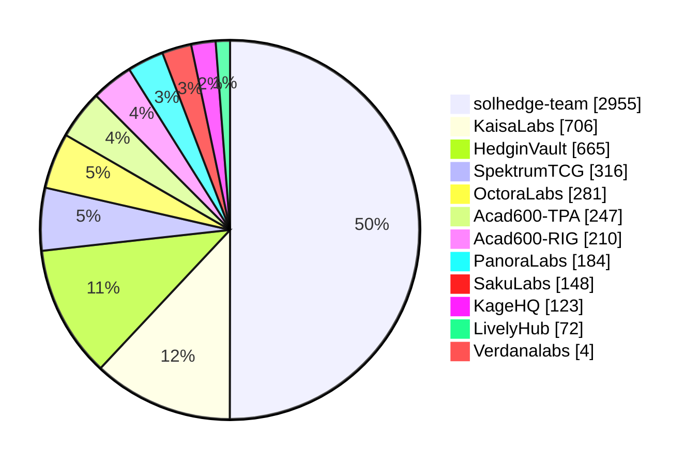

# Hi, I'm Theo 👋

### 🧭 About me

- 🏢 Full-time **Laboratory Assistant** at **BINUS University**
- 🌱 Leveling up in **full stack development** and **Web3**
- 🚀 Building **[SolHedge](https://github.com/solhedge-team)** · **[Hedgin](https://github.com/HedginVault)** · **XFlare**

---

### 🛠️ Tech stack

  <b>Languages</b> 
  

  <b>Frontend</b> 
  

  <b>Backend & Data</b> 
  

  <b>Cloud & DevOps</b> 
  

  <b>ML & Design</b> 
  

---

### 📊 Activity

  

#### 🏢 Commits

**5,911 commits** (default branches, as of Oct 2026).

---

### 🐍 Contribution snake

